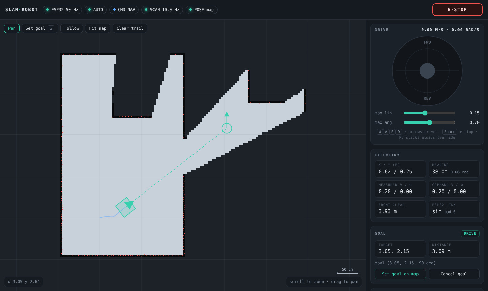
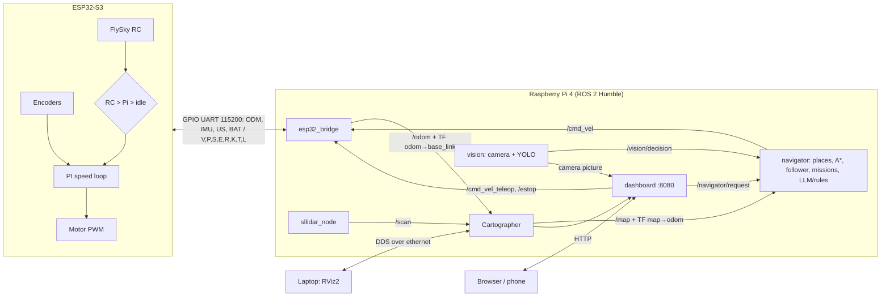

# SLAM Robot — ROS 2 differential-drive robot with LiDAR SLAM

An indoor mobile robot that maps a building with **Cartographer SLAM**, remembers **named places**,
plans **routes around walls (A\*)**, takes **plain-English / Hinglish commands**, typed or spoken
(Groq LLM with an offline fallback), runs a **priority mission queue**, **recovers from failures** (an LLM
picks from a fixed menu of safe actions, rules when offline), **docks nose-first on an ArUco marker**, avoids
people with the camera, and can be driven from an RC transmitter, the Pathik phone app (also over the
internet) or RViz. Wheel-encoder odometry comes from an ESP32.

| | |
|---|---|
| Compute | Raspberry Pi 4, Ubuntu 22.04, ROS 2 Humble (headless) |
| LiDAR | Slamtec RPLiDAR A1M8, 360°, 10 Hz, 12 m |
| Low-level | ESP32-S3-DevKitC-1, firmware v2.7 (`firmware/robot_esp32s3`, on the Pi's GPIO UART `/dev/ttyAMA0`) or classic ESP32, v2.5 (`firmware/robot_esp32_classic`, USB): motor PWM, quadrature encoders, PI wheel-speed loop, RC input, docking mode, I2C scan |
| Drive | 2 × DC gear motors with encoders (~4970 ticks/rev), BTS7960 H-bridges, 125 mm wheels, 300 mm track |
| Manual | FlySky FS-i6 + FS-iA6 receiver (always overrides software) |
| Extra sensors (v2.2) | MPU-6050 gyro (heading), 3× HC-SR04 (low obstacles), mushroom e-stop (hardware cut + sense): [hardware/sensors.md](hardware/sensors.md) |
| SLAM | Cartographer 2D (LiDAR + odometry, or LiDAR-only fallback) |
| Camera | Camera Module 3 Wide: YOLO11n people detection, slows / stops for people ([docs/STEPS_camera.md](docs/STEPS_camera.md)); dock marker for front docking ([docs/docking.md](docs/docking.md)) |
| Voice | USB sound card, push-to-talk button (Pi GPIO17), Groq Whisper / Vosk offline, Piper voice ([docs/STEPS_voice.md](docs/STEPS_voice.md)) |
| Wiring | every wire, both ends: [hardware/CONNECTIONS_esp32s3.md](hardware/CONNECTIONS_esp32s3.md) |


<sub>Web app (here on `tools/dashboard_sim.py`): planned route, place pins, natural-language command, mission queue, LiDAR, e-stop.</sub>

## Architecture



**TF tree:** `map → odom → base_link → laser`
**Command priority:** E-stop (latched in the ESP32) › RC sticks › dashboard teleop › navigator › stop.
Every layer has a watchdog: browser → 0.5 s, bridge → 0.5 s, ESP32 → 0.3 s, RC signal loss → 0.1 s,
stale SLAM pose → goal controller stops in 0.6 s.

## Repository layout

```
firmware/robot_esp32s3/      ESP32-S3 sketch v2.7 (the robot's board; Pi link on the GPIO UART)
firmware/robot_esp32_classic/ classic ESP32 sketch v2.5 (USB link)   · firmware/robot_esp32/: legacy v2.2
ros2_ws/src/lidar_robot/     ROS 2 package (ament_python)
  lidar_robot/               esp32_bridge, navigator, dashboard, goal_controller, vision, voice (+ pure-Python logic:
                             planner, follower, places, commands, missions, navigator_core, auth, vision_rules,
                             recovery, docking, marker_pose, voice, speech, urdf_model)
  urdf/pathik.urdf.xacro     robot model (robot_state_publisher)
  lidar_robot/web/app/       the Pathik app (also bundled in the Android APK, android/); web/index.html = classic page
  config/                    robot_params.yaml, cartographer_{odom,lidar_only,localization}.lua
  launch/bringup.launch.py   one launch file for everything
  test/                      unit tests, controller simulation, bridge-over-pty integration test
tools/                       serial_probe.py (debug/calibrate ESP32), dashboard_sim.py (UI without robot),
                             link_doctor.sh, robot_check.sh, eval_nav.py, eval_commands.py, eval_recovery.py,
                             marker_webcam.py (dock marker on a laptop webcam / print it)
results/                     evaluation output (recovery_eval.md)
scripts/mcp_server.py        MCP server: AI assistants (Claude) can drive the robot ([docs/mcp.md](docs/mcp.md))
rviz/robot.rviz              RViz2 layout for the laptop
udev/ scripts/               stable /dev names, laptop ethernet setup, systemd autostart
hardware/                    pin map, wiring, BOM, CAD, photos
docs/                        START_TODAY (do this first), deploy, calibration, navigation (app + API), exploration, remote access,
                             mobile app, troubleshooting, roadmap
maps/                        saved maps (.pgm + .yaml)
```

## Quick start

On the Pi (full guide: [docs/deploy.md](docs/deploy.md)):

```bash
cd ~/ros2_ws && colcon build --symlink-install --packages-select lidar_robot
source install/setup.bash
ros2 launch lidar_robot bringup.launch.py                      # map the floor (then Save map)
ros2 launch lidar_robot bringup.launch.py slam_mode:=localization map:=~/maps/cse_floor.pbstream
ros2 launch lidar_robot bringup.launch.py use_odometry:=false  # LiDAR-only fallback
```

On the laptop:

```bash
rviz2 -d rviz/robot.rviz          # use the "2D Goal Pose" tool to send the robot somewhere
xdg-open http://169.254.1.2:8080  # web dashboard: joystick, e-stop, map, click-to-goal, save map
```

**Phone app (Pathik):** drive, send the robot to places, and tune it from Android: see
[docs/mobile_app.md](docs/mobile_app.md). The APK is built by GitHub Actions; the same app also opens in any
browser at `http://<robot>:8080`.

**Map by itself:** the robot explores and maps rooms on its own, slowly, for clean maps, then returns
and saves the map: [docs/exploration.md](docs/exploration.md).
**Robot in another lab / control from mobile data:** phone-on-robot hotspot + Tailscale (or a public Funnel
link with logins): [docs/STEPS_remote_control.md](docs/STEPS_remote_control.md).
**Error recovery** ([docs/recovery.md](docs/recovery.md)), **front docking** ([docs/docking.md](docs/docking.md)),
**voice** ([docs/STEPS_voice.md](docs/STEPS_voice.md)), **keys and accounts** ([docs/KEYS.md](docs/KEYS.md)).
**Campus deployment:** logins with roles (admin / operator / staff), Docker image built and tested by CI,
one-command updates with automatic rollback: [docs/deployment.md](docs/deployment.md).

No robot? `python3 tools/dashboard_sim.py` runs the app against a simulated robot
(`--explore` starts with an empty map to try Map by itself).

## Status

Done and verified on the robot (classic ESP32 build, Oct 2026):
- [x] LiDAR → Cartographer → live map (15.5 × 12.2 m floor), ESP32 link ~50 Hz, encoder odometry, ultrasonics
- [x] Navigator driving: places, A* routes, path following, priority mission queue, NL commands
- [x] Pathik app on the phone; ESP32-S3 v2.6 on the Pi's GPIO UART (ODM / US lines verified on `/dev/ttyAMA0`)

Done in code + tests, still to be tried on the robot (see [docs/WORK_LEFT.md](docs/WORK_LEFT.md)):
- [x] Logins with roles (staff / operator / admin), Docker image + CI, MCP server
- [x] Real body shape in planning, 3-point turns, battery + dock, rooms with contents, schedules, "why did you stop?", mission log
- [x] Camera people avoidance (Camera Module 3 + YOLO11n, LiDAR distance) + camera view in the app
- [x] Frontier exploration (Map by itself), Tuning Lab, remote access over Tailscale (+ Funnel, slow-link joystick pause)
- [x] Redesigned app (Home · Send · Map · Drive · Operate; every old feature kept: [docs/APP_FEATURES.md](docs/APP_FEATURES.md))
- [x] LLM error recovery with a fixed safe-action menu + rules fallback (sim: rules 6/6 vs no recovery 1/6)
- [x] Front docking on an ArUco marker (firmware docking mode), voice push-to-talk + Piper, URDF model
- [ ] On the robot: IMU on the S3 (v2.7 `I` scan), footprint + wheel separation + camera mount measured,
      dock, voice and recovery tried on the real floor (checklist: [docs/STEPS_next_run.md](docs/STEPS_next_run.md))

## Tests

```bash
cd ros2_ws/src/lidar_robot && python3 -m pytest test/     # no ROS needed
python3 tools/eval_nav.py                                  # navigation benchmark in the simulator
python3 tools/eval_recovery.py                             # error recovery: none vs rules vs LLM -> results/
node ros2_ws/src/lidar_robot/test/app_parity.js            # app: every feature reachable per role (demo)
```

## License

MIT — see [LICENSE](LICENSE).
